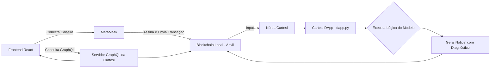

# ⚙️ EpiScope DApp - Backend Descentralizado (Cartesi Machine)

O **EpiScope-dapp** é o componente **Web3** do projeto **EpiScope - Analisador de Doenças com IA e Blockchain** 🧬.  
Ele executa, de forma **descentralizada e verificável**, a lógica de diagnóstico de arboviroses (**Dengue, Zika e Chikungunya**) exportada do modelo de Machine Learning desenvolvido no backend Web2.  

O DApp roda dentro da **Cartesi Machine**, garantindo **transparência, auditabilidade e imutabilidade** dos resultados.

---

## 📜 Índice
- 💡 [Visão Geral](#-visão-geral)
- 🧠 [Como Funciona](#-como-funciona)
- 🛠️ [Tecnologias Utilizadas](#-tecnologias-utilizadas)
- 🚀 [Instalação e Execução](#-instalação-e-execução)
- 🧩 [Estrutura do Projeto](#-estrutura-do-projeto)
- 🔄 [Fluxo de Integração com o Sistema Principal](#-fluxo-de-integração-com-o-sistema-principal)
- 🧪 [Testando Localmente](#-testando-localmente)
- 🔮 [Próximos Passos](#-próximos-passos)
- ⚖️ [Licença](#-licença)

---

## 💡 Visão Geral

O **EpiScope DApp** recebe os mesmos dados de entrada que a API Web2 (sintomas, dados demográficos e clínicos),  
mas o processamento é feito **dentro de um ambiente isolado da Cartesi**, com lógica determinística e auditável.

> 🔐 Isso significa que **ninguém pode alterar o resultado** sem que toda a rede perceba — o diagnóstico é **verificável e confiável**.

---

## 🧠 Como Funciona

1. O usuário acessa o **Frontend React** e escolhe o modo **Web3**.  
2. A **MetaMask** é usada para assinar e enviar a transação com os dados de entrada.  
3. O **Cartesi Node** recebe a transação e executa o código do **DApp (dapp.py)**.  
4. O DApp processa os dados e emite uma **Notice** com o diagnóstico.  
5. O frontend consulta o **servidor GraphQL da Cartesi** para buscar o resultado e exibir ao usuário.

### 🔁 Fluxo de Execução (Mermaid)



---

## 🛠️ Tecnologias Utilizadas

- **Python (mínimo e determinístico)**  
- **Cartesi Rollups SDK**  
- **Cartesi CLI (sunodo/cartesi)**  
- **Docker**  
- **GraphQL (Cartesi Node)**  
- **MetaMask** para interação Web3

---

## 🚀 Instalação e Execução

### Pré-requisitos
- **Cartesi CLI** (`cartesi` ou `sunodo`) instalado globalmente.  
- **Docker** em execução.  
- O **modelo exportado** do projeto principal (**EpiScope---Disease-Data-Analyzer**) deve estar colado na função `predict_diagnosis` no arquivo `dapp.py`.

---

### 1️⃣ Clonar o Repositório

```bash
git clone https://github.com/bisnet0/EpiScope-dapp.git
cd EpiScope-dapp
```

---

### 2️⃣ Conferir os Arquivos Principais

- `dapp.py` → contém a lógica do modelo (if/else exportado).  
- `Dockerfile` → define a imagem leve (sem bibliotecas pesadas como pandas ou sklearn).  
- `requirements.txt` → apenas dependências mínimas do Cartesi SDK.

---

### 3️⃣ Construir e Executar o DApp

```bash
cartesi build
cartesi run
```

Isso inicializa o DApp dentro de uma **Cartesi Machine** local.  
Durante a execução, você verá logs indicando o processamento das requisições e a geração de “notices”.

---

### 4️⃣ Interagir com o DApp via Frontend

No **Frontend React** do projeto principal, selecione **Modo Web3** e envie os sintomas.  
A MetaMask assinará a transação e o DApp retornará o diagnóstico de forma descentralizada.

---

## 🧩 Estrutura do Projeto

```
EpiScope-dapp/
├── dapp.py              # Lógica principal do DApp
├── requirements.txt     # Dependências mínimas do ambiente
├── Dockerfile           # Configuração da imagem do DApp
└── README.md            # Este arquivo
```

---

## 🔄 Fluxo de Integração com o Sistema Principal

O **EpiScope-dapp** depende do código gerado pelo backend Web2.

1. O modelo é treinado no `EpiScope---Disease-Data-Analyzer/backend/train_model.py`.  
2. O script `export_model_logic.py` converte a árvore de decisão em **condições Python puras**.  
3. Esse código é colado na função `predict_diagnosis()` do `dapp.py`.  
4. O DApp executa essa função dentro da Cartesi Machine sempre que uma transação é recebida.

---

## 🧪 Testando Localmente

Você pode simular uma requisição ao DApp com o comando:

```bash
cartesi send generic --input '{"fever": true, "rash": false, "joint_pain": true}'
```

O output esperado será uma **Notice JSON** com o diagnóstico, como:

```json
{
  "disease": "Chikungunya",
  "confidence": 0.87,
  "timestamp": "2025-10-17T18:00:00Z"
}
```

---

## 🔮 Próximos Passos

- [ ] Implementar suporte a logs estruturados JSON para validação automática.  
- [ ] Integrar o DApp a uma **testnet Cartesi pública**.  
- [ ] Criar testes unitários determinísticos para validação de previsões.  
- [ ] Desenvolver script de CI/CD com build automático via Cartesi CLI.

---

## ⚖️ Licença

Este projeto está sob a licença **MIT**.  
Parte integrante do **EpiScope Project (2025)**.  
Criado com 🧠 por **Henrique Bisneto**.  
